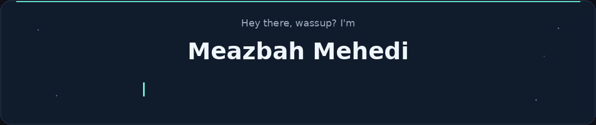

<picture>
  <source media="(prefers-reduced-motion: reduce)" srcset="./assets/space-banner-static.png" />
  
</picture>

<picture>
  <source media="(prefers-reduced-motion: reduce)" srcset="./assets/intro-static.png" />
  
</picture>

---

## 👨‍💻 About me

<picture>
  <source media="(prefers-reduced-motion: reduce)" srcset="./assets/panda-static.png" />
  
</picture>

Welcome to my GitHub profile! I'm currently a student aspiring to become a software engineer. While I may not have extensive coding skills or knowledge at the moment, I'm actively learning and consider myself a quick learner. I'm excited to embark on this journey and develop my coding abilities. Stay tuned for future projects and progress!

🌱 **I'm currently learning Python.**

📫 **How to reach me:** [meazbahmehedi@gmail.com](mailto:meazbahmehedi@gmail.com)

 

## 💬 My mindset

> I'm the type of person that if you ask me a question and I don't know the answer, I'm gonna tell you that I don't know. But I bet you what, I know how to find the answer and I will find the answer.

---

## 🛠 Languages and tools

<table>
  <tr>
    <td align="center" width="140">
      
       <strong>C</strong>
    </td>
    <td align="center" width="140">
      
       <strong>C++</strong>
    </td>
    <td align="center" width="140">
      
       <strong>Python</strong>
    </td>
  </tr>
</table>

## 📊 Daily commits

<picture>
  <source media="(prefers-color-scheme: dark)" srcset="./assets/daily-commits-dark.svg" />
  <source media="(prefers-color-scheme: light)" srcset="./assets/daily-commits-light.svg" />
  
</picture>

  <a href="./data/DAILY-COMMITS.md">View daily counts</a> &nbsp; · &nbsp;
  <a href="./data/daily-commits.csv">CSV data</a>

Unique public commits indexed by GitHub on default branches, grouped by author date in UTC. Includes merge commits. Refreshed daily; today's count is partial.

## 📈 Contribution activity

<picture>
  <source media="(prefers-color-scheme: dark)" srcset="./assets/activity-dark.svg" />
  <source media="(prefers-color-scheme: light)" srcset="./assets/activity-light.svg" />
  
</picture>

Contributions include commits, issues, pull requests and other eligible activity.

## 🐍 Contribution snake

<picture>
  <source media="(prefers-color-scheme: dark)" srcset="./assets/snake-dark.svg" />
  <source media="(prefers-color-scheme: light)" srcset="./assets/snake-light.svg" />
  
</picture>

---

## 🌐 Connect with me

  
  
  
  
  
  
  

---
