

<picture>
  <source media="(prefers-reduced-motion: reduce)" srcset="./assets/space-banner-static.png" />
  
</picture>

<picture>
  <source media="(prefers-reduced-motion: reduce)" srcset="./assets/intro-static.png" />
  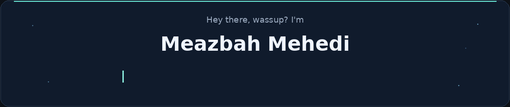
</picture>

<picture>
  <source media="(prefers-color-scheme: light)" srcset="./assets/tagline-light.svg" />
  
</picture>

<a href="https://www.linkedin.com/in/meazbahmehedi/" target="_blank" rel="noopener noreferrer">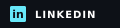</a>

<picture>
  <source media="(prefers-color-scheme: light)" srcset="./assets/divider-light.svg" />
  
</picture>

## 👨‍💻 About me

<picture>
  <source media="(prefers-reduced-motion: reduce)" srcset="./assets/panda-static.png" />
  
</picture>

I'm a software developer from Bangladesh who builds practical Python tools for security, accessibility and machine-learning evaluation. I like work where the result can be checked: a scanner that shows its evidence, a detector with its own evaluation lab, a reproduction study with confidence intervals.

**🔭 Currently**

<!-- SYNC:CURRENT:START -->
- **Working on** — <a href="https://github.com/MeazbahMehedi/CSTBS-PHP">CSTBS-PHP</a>: Campus stadium ticket booking, signed QR admission and gate operations built with PHP and MariaDB for XAMPP
- **Working on** — <a href="https://github.com/MeazbahMehedi/medevo-evaluation">medevo-evaluation</a>: Independent CPU-scale evaluation of MedEvo on VQA-RAD and SLAKE: frozen protocol, test baselines, reference-free repair and LoRA a
- **Working on** — <a href="https://github.com/MeazbahMehedi/road-damage-dg">road-damage-dg</a>: Robust and Efficient Road Damage Detection Under Domain Shift
- **Working on** — <a href="https://github.com/MeazbahMehedi/emessa-business-manager">emessa-business-manager</a>: Inventory and warehouse management for EMESSA. Work in progress.
<!-- SYNC:CURRENT:END -->

 

## 💬 My mindset

<picture>
  <source media="(prefers-reduced-motion: reduce) and (prefers-color-scheme: light)" srcset="./assets/mindset-static-light.svg" />
  <source media="(prefers-reduced-motion: reduce)" srcset="./assets/mindset-static.svg" />
  <source media="(prefers-color-scheme: light)" srcset="./assets/mindset-light.svg" />
  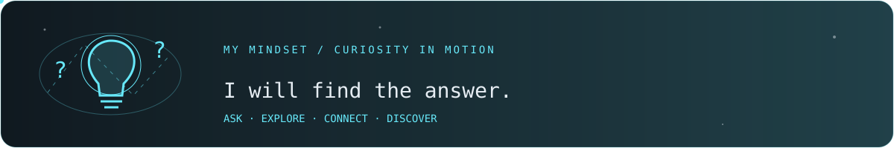
</picture>

> I'm the type of person that if you ask me a question and I don't know the answer, I'm gonna tell you that I don't know. But I bet you what, I know how to find the answer and I will find the answer.

<picture>
  <source media="(prefers-color-scheme: light)" srcset="./assets/divider-light.svg" />
  
</picture>

## 🚀 Featured projects

<!-- SYNC:PROJECTS:START -->

<a href="https://github.com/MeazbahMehedi/CSTBS-PHP"><picture><source media="(prefers-color-scheme: light)" srcset="./assets/project-live-1-light.svg" />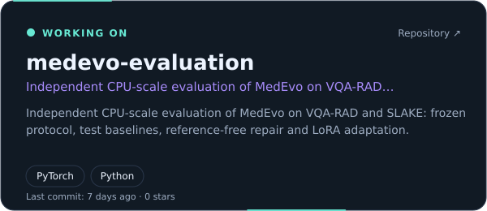</picture></a>
<a href="https://github.com/MeazbahMehedi/medevo-evaluation"><picture><source media="(prefers-color-scheme: light)" srcset="./assets/project-live-2-light.svg" />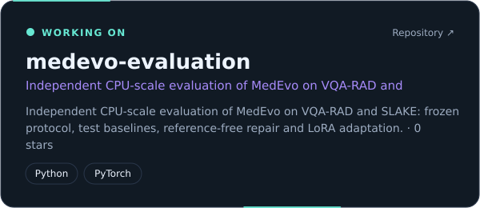</picture></a>

<a href="https://github.com/MeazbahMehedi/road-damage-dg"><picture><source media="(prefers-color-scheme: light)" srcset="./assets/project-live-3-light.svg" />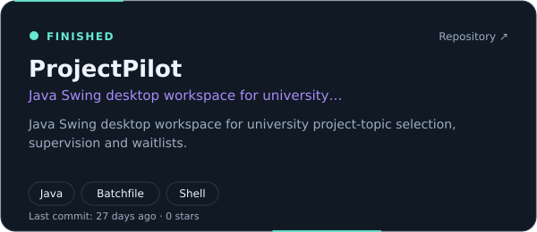</picture></a>
<a href="https://github.com/MeazbahMehedi/emessa-business-manager"><picture><source media="(prefers-color-scheme: light)" srcset="./assets/project-live-4-light.svg" />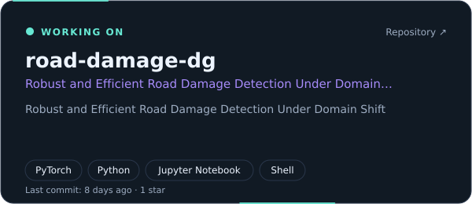</picture></a>

<!-- SYNC:PROJECTS:END -->

## 🛠 Languages and tools

<!-- SYNC:TOOLS:START -->
<table>
<tr><td><strong>Languages</strong></td><td><picture><source media="(prefers-color-scheme: light)" srcset="https://skillicons.dev/icons?i=python,css,js,html,ts,php,java,c,bash&amp;theme=light" /></picture></td></tr>
<tr><td><strong>Frameworks and data</strong></td><td><picture><source media="(prefers-color-scheme: light)" srcset="https://skillicons.dev/icons?i=fastapi,flask,pytorch,react,sqlite&amp;theme=light" /></picture></td></tr>
<tr><td><strong>Tools</strong></td><td><picture><source media="(prefers-color-scheme: light)" srcset="https://skillicons.dev/icons?i=docker,git,github,githubactions&amp;theme=light" /></picture></td></tr>
</table>

Detected from public repositories and dependency files. Refreshes hourly.
<!-- SYNC:TOOLS:END -->

<picture>
  <source media="(prefers-color-scheme: light)" srcset="./assets/divider-light.svg" />
  
</picture>

## 📊 Profile stats

<picture>
  <source media="(prefers-color-scheme: dark)" srcset="./assets/stats-dark.svg" />
  <source media="(prefers-color-scheme: light)" srcset="./assets/stats-light.svg" />
  
</picture>

Totals cover the last 31 UTC dates. Languages are GitHub's byte counts across my own public, non-fork repositories. Refreshed hourly.

## 📈 Daily commits

<picture>
  <source media="(prefers-color-scheme: dark)" srcset="./assets/daily-commits-dark.svg" />
  <source media="(prefers-color-scheme: light)" srcset="./assets/daily-commits-light.svg" />
  
</picture>

  <a href="./data/DAILY-COMMITS.md">View daily counts</a> &nbsp; · &nbsp;
  <a href="./data/daily-commits.csv">CSV data</a>

Unique public commits indexed by GitHub on default branches, grouped by author date in UTC. Includes merge commits. Refreshed hourly; today's count is partial.

## 🗓 Contribution activity

<picture>
  <source media="(prefers-color-scheme: dark)" srcset="./assets/activity-dark.svg" />
  <source media="(prefers-color-scheme: light)" srcset="./assets/activity-light.svg" />
  
</picture>

Contributions include commits, issues, pull requests and other eligible activity.

## 🐍 Contribution snake

<picture>
  <source media="(prefers-color-scheme: dark)" srcset="./assets/snake-dark.svg" />
  <source media="(prefers-color-scheme: light)" srcset="./assets/snake-light.svg" />
  
</picture>

<picture>
  <source media="(prefers-color-scheme: light)" srcset="./assets/divider-light.svg" />
  
</picture>

## 🌐 Connect with me

  
  
  
  
  
  

<picture>
  <source media="(prefers-color-scheme: light)" srcset="./assets/footer-light.svg" />
  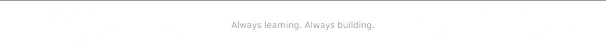
</picture>
