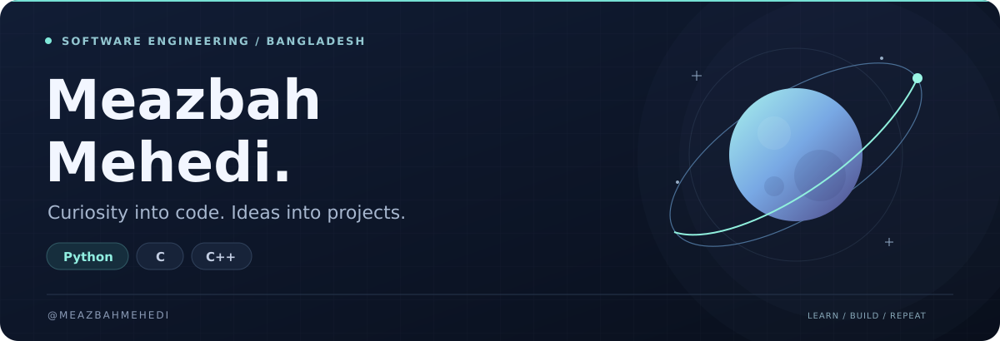
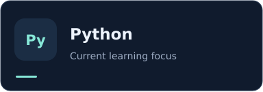
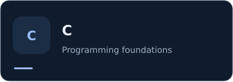
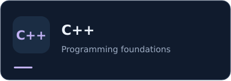
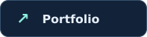
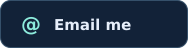
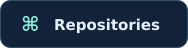
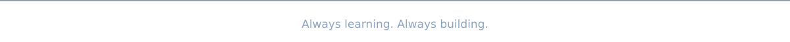

<!-- Custom visuals are stored in assets/ so the profile does not depend on external badge or stats services. -->

  

  <a href="https://www.meazbahmehedi.com"><strong>Portfolio</strong></a> &nbsp; · &nbsp;
  <a href="https://github.com/MeazbahMehedi?tab=repositories"><strong>Projects</strong></a> &nbsp; · &nbsp;
  <a href="mailto:meazbahmehedi@gmail.com"><strong>Contact</strong></a>

## A little about me

I'm **Meazbah Mehedi**, a software engineering student from **Bangladesh**. I'm developing my programming skills through hands-on practice, with **Python** as my current focus.

I enjoy breaking down problems, understanding how things work, and turning what I learn into small, useful projects. This profile is where I share that progress.

## What I'm focused on

| Python | Core foundations | Learning by building |
| :--- | :--- | :--- |
| Strengthening my understanding of Python through consistent practice. | Developing problem-solving skills and a solid foundation in C and C++. | Applying new concepts in small projects and improving them as I learn. |

## Languages I'm working with

  
  
  

## How I approach learning

> If I don't know the answer, I'll be honest about it—and put in the work to find it.

I value curiosity, clear thinking, and steady progress. Every problem is an opportunity to learn something I can use in the next project.

## Let's connect

Interested in exchanging ideas, sharing feedback, or learning together? Feel free to reach out.

  
  
  

**Email:** [meazbahmehedi@gmail.com](mailto:meazbahmehedi@gmail.com)

<strong>Find me elsewhere</strong>

- [X / Twitter](https://twitter.com/meazbahmehedi)
- [Facebook](https://fb.com/meazbahmehedi)
- [Instagram](https://instagram.com/meazbah.mehedi)
- [YouTube](https://www.youtube.com/c/meazbahmehedi)
- [Discord](https://discord.com/invite/pCxqQYZQHf)

 

