

<picture>
  <source media="(prefers-reduced-motion: reduce)" srcset="./assets/space-banner-static.png" />
  
</picture>

<picture>
  <source media="(prefers-reduced-motion: reduce)" srcset="./assets/intro-static.png" />
  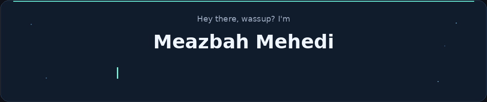
</picture>

<picture>
  <source media="(prefers-color-scheme: light)" srcset="./assets/tagline-light.svg" />
  
</picture>

<a href="https://www.linkedin.com/in/meazbahmehedi/" target="_blank" rel="noopener noreferrer">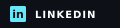</a>

<picture>
  <source media="(prefers-color-scheme: light)" srcset="./assets/divider-light.svg" />
  
</picture>

## 👨‍💻 About me

<picture>
  <source media="(prefers-reduced-motion: reduce)" srcset="./assets/panda-static.png" />
  
</picture>

I'm a software developer from Bangladesh who builds practical Python tools for security, accessibility and machine-learning evaluation. I like work where the result can be checked: a scanner that shows its evidence, a detector with its own evaluation lab, a reproduction study with confidence intervals.

**🔭 Currently**

- 🔬 **Researching** how reliable static-analysis security findings are in AI-generated Python pull requests
- 🧪 **Evaluating** the [MedEvo](https://github.com/MeazbahMehedi/medevo-evaluation) medical reasoning method on VQA-RAD and SLAKE
- 🛡️ **Building** [IntentShield](https://github.com/MeazbahMehedi/PromptGuard), a prompt-injection detection and evaluation workspace
- 🤝 **Open to** research collaborations and master's opportunities in computer science and AI

 

## 💬 My mindset

> I'm the type of person that if you ask me a question and I don't know the answer, I'm gonna tell you that I don't know. But I bet you what, I know how to find the answer and I will find the answer.

<picture>
  <source media="(prefers-color-scheme: light)" srcset="./assets/divider-light.svg" />
  
</picture>

## 🚀 Featured projects

  <a href="https://github.com/MeazbahMehedi/PromptGuard"><picture>
    <source media="(prefers-color-scheme: light)" srcset="./assets/project-intentshield-light.svg" />
    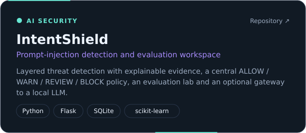
  </picture></a>
  <a href="https://github.com/MeazbahMehedi/AccessCheck"><picture>
    <source media="(prefers-color-scheme: light)" srcset="./assets/project-accesslens-light.svg" />
    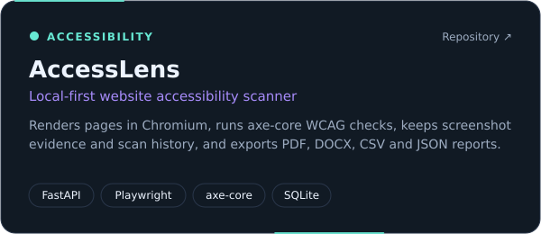
  </picture></a>

  <a href="https://github.com/MeazbahMehedi/medevo-evaluation"><picture>
    <source media="(prefers-color-scheme: light)" srcset="./assets/project-medevo-evaluation-light.svg" />
    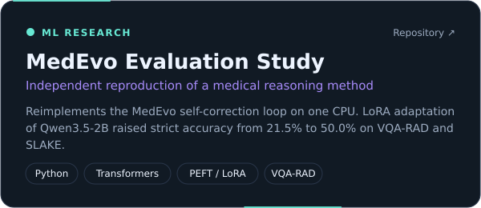
  </picture></a>
  <a href="https://github.com/MeazbahMehedi/CampusFind"><picture>
    <source media="(prefers-color-scheme: light)" srcset="./assets/project-campusfind-light.svg" />
    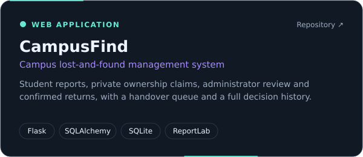
  </picture></a>

## 🛠 Languages and tools

<table>
  <tr>
    <td><strong>Languages</strong></td>
    <td><picture><source media="(prefers-color-scheme: light)" srcset="https://skillicons.dev/icons?i=python,c,cpp,js,html,css&amp;theme=light" /></picture></td>
  </tr>
  <tr>
    <td><strong>Frameworks and data</strong></td>
    <td><picture><source media="(prefers-color-scheme: light)" srcset="https://skillicons.dev/icons?i=flask,fastapi,pytorch,sqlite&amp;theme=light" /></picture></td>
  </tr>
  <tr>
    <td><strong>Tools</strong></td>
    <td><picture><source media="(prefers-color-scheme: light)" srcset="https://skillicons.dev/icons?i=git,githubactions,docker,linux,pycharm&amp;theme=light" /></picture></td>
  </tr>
</table>

<picture>
  <source media="(prefers-color-scheme: light)" srcset="./assets/divider-light.svg" />
  
</picture>

## 📊 Profile stats

<picture>
  <source media="(prefers-color-scheme: dark)" srcset="./assets/stats-dark.svg" />
  <source media="(prefers-color-scheme: light)" srcset="./assets/stats-light.svg" />
  
</picture>

Totals cover the last 31 UTC dates. Languages are GitHub's byte counts across my own public, non-fork repositories. Refreshed daily.

## 📈 Daily commits

<picture>
  <source media="(prefers-color-scheme: dark)" srcset="./assets/daily-commits-dark.svg" />
  <source media="(prefers-color-scheme: light)" srcset="./assets/daily-commits-light.svg" />
  
</picture>

  <a href="./data/DAILY-COMMITS.md">View daily counts</a> &nbsp; · &nbsp;
  <a href="./data/daily-commits.csv">CSV data</a>

Unique public commits indexed by GitHub on default branches, grouped by author date in UTC. Includes merge commits. Refreshed daily; today's count is partial.

## 🗓 Contribution activity

<picture>
  <source media="(prefers-color-scheme: dark)" srcset="./assets/activity-dark.svg" />
  <source media="(prefers-color-scheme: light)" srcset="./assets/activity-light.svg" />
  
</picture>

Contributions include commits, issues, pull requests and other eligible activity.

## 🐍 Contribution snake

<picture>
  <source media="(prefers-color-scheme: dark)" srcset="./assets/snake-dark.svg" />
  <source media="(prefers-color-scheme: light)" srcset="./assets/snake-light.svg" />
  
</picture>

<picture>
  <source media="(prefers-color-scheme: light)" srcset="./assets/divider-light.svg" />
  
</picture>

## 🌐 Connect with me

  
  
  
  
  
  

<picture>
  <source media="(prefers-color-scheme: light)" srcset="./assets/footer-light.svg" />
  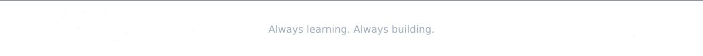
</picture>
